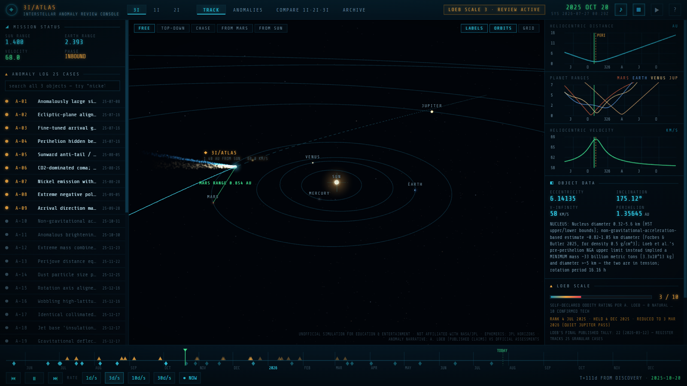
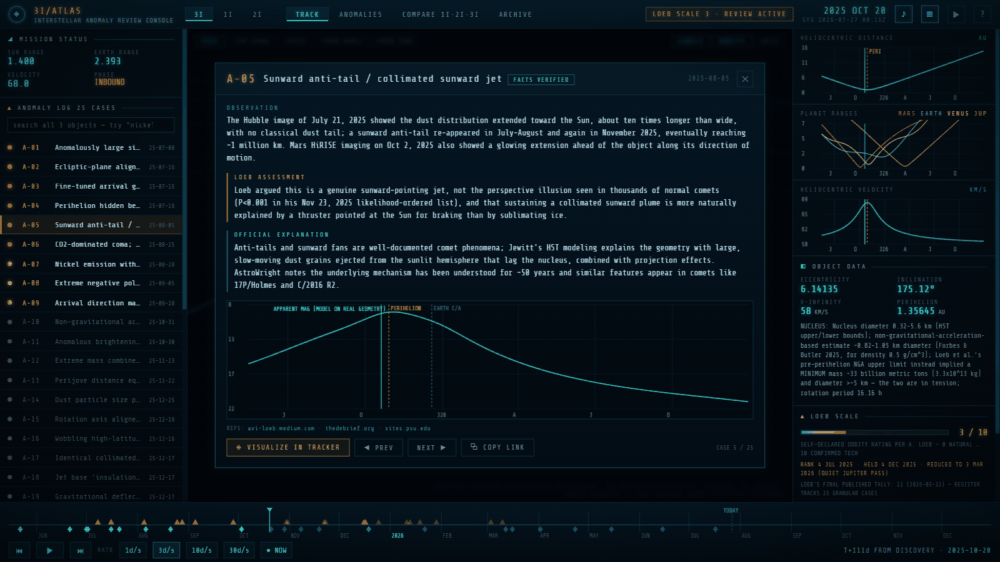
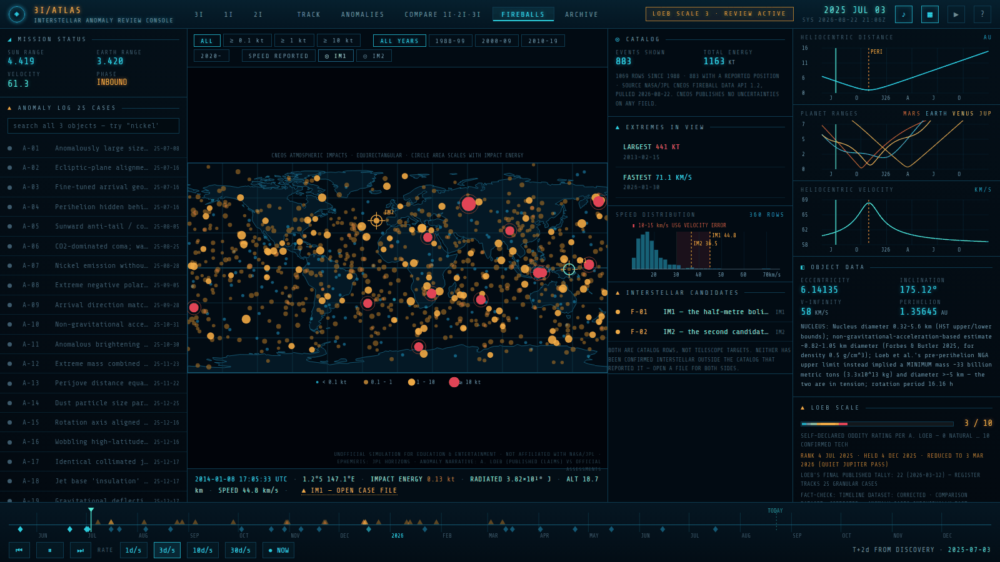
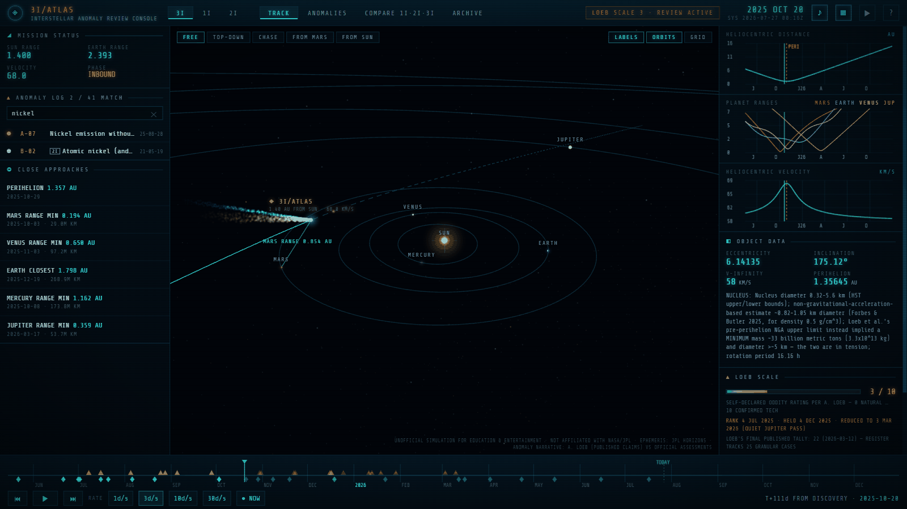
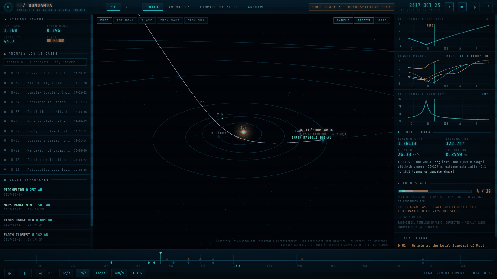
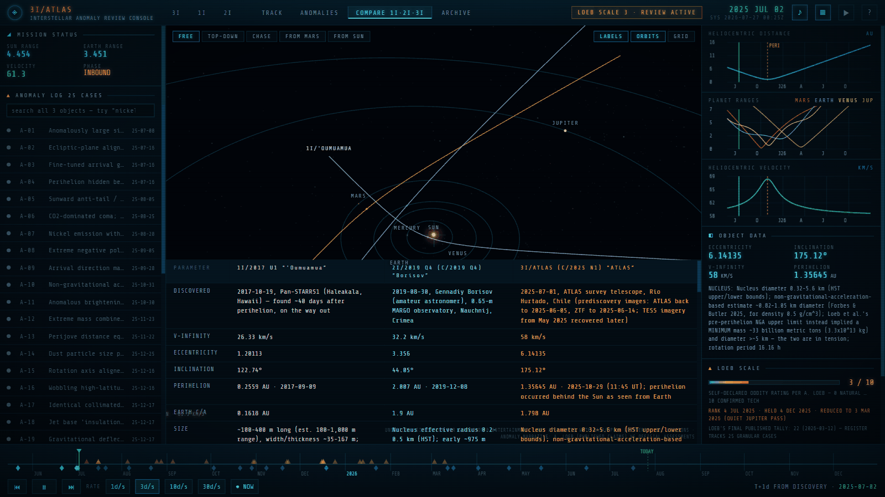
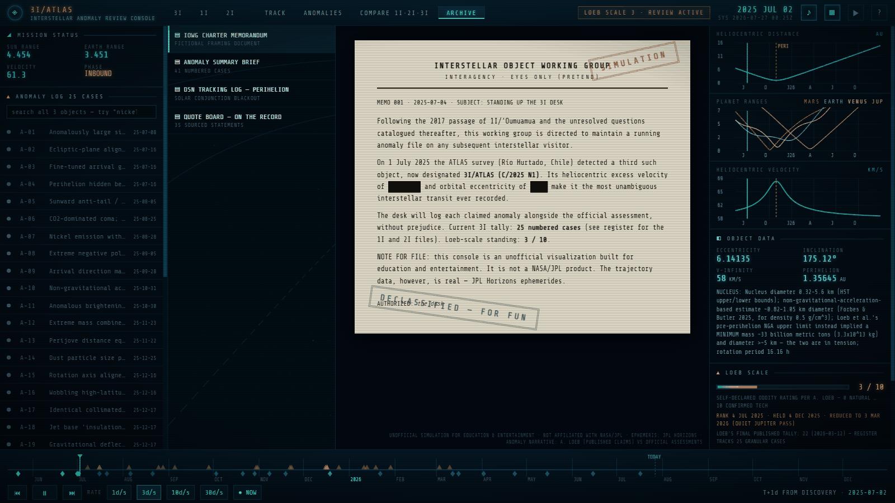
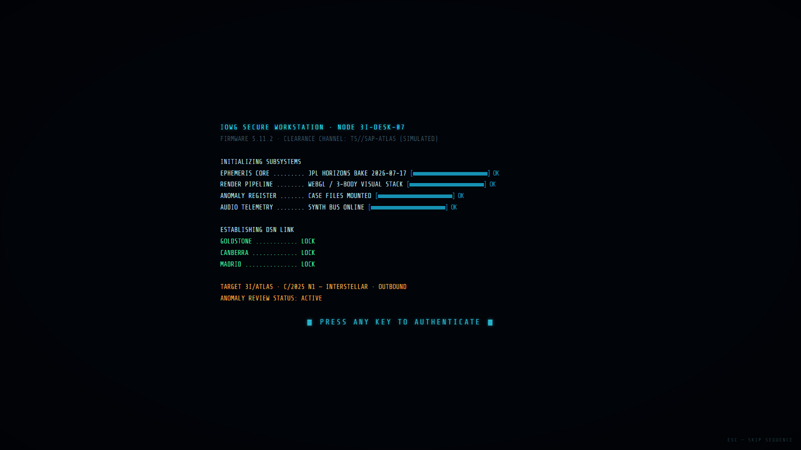

<div align="center">

# 3I/ATLAS: Interstellar Anomaly Review Console


**A mission-control terminal for the only three objects ever seen entering our solar system from interstellar space.**

Real trajectories. Real measurements. Both sides of every argument.

[](https://3i-atlas-anomaly-console.pages.dev)
[](https://3i-atlas-landing.pages.dev)
[](https://3i-atlas-anomaly-console.pages.dev/about.html)
[](LICENSE)


### ▶ **[Launch the console](https://3i-atlas-anomaly-console.pages.dev)**

</div>

<!-- tracking:start -->
> ### Now tracking: The Angry Astronaut and Avi Loeb
>
> This console follows two running sources on 3I/ATLAS and the fireball claims, and checks
> each new claim against the data as it comes in.
>
> - **[The Angry Astronaut](https://www.youtube.com/@TheAngryAstronaut)** on YouTube: now including data through **[NO KIDDING! 3I Atlas changing course and speeding up! Where is Avi Loeb?](https://www.youtube.com/watch?v=ihnlxrNdhEQ)** (1 November 2026), built into [briefing BR-09](https://3i-atlas-anomaly-console.pages.dev/#brief/BR-09), [case A-10](https://3i-atlas-anomaly-console.pages.dev/#3i/A-10) and [case A-24](https://3i-atlas-anomaly-console.pages.dev/#3i/A-24).
> - **[Avi Loeb](https://avi-loeb.medium.com/)** on Medium: through **[The Pomegranates That Seeded Life in the Universe](https://avi-loeb.medium.com/the-pomegranates-that-seeded-life-in-the-universe-fcb29dce1428)** (21 October 2026), built into [case A-26](https://3i-atlas-anomaly-console.pages.dev/#3i/A-26).
>
> Everything else is checked against the published record to 1 November 2026.
<!-- tracking:end -->



---

## What this is

In 2017 a tumbling, tail-less object called **1I/ʻOumuamua** passed through the solar system and
accelerated on its way out with nothing visibly pushing it. In 2019 **2I/Borisov** arrived and
behaved like a perfectly ordinary comet. In 2025 **3I/ATLAS** came through on the most extreme
hyperbolic orbit ever measured, and Harvard astronomer Avi Loeb began publishing a numbered list
of things about it he considered anomalous, eventually reaching 22 items.

Most astronomers say it's a comet. Loeb says the list deserves an answer.

**This console doesn't pick for you.** Every case file states what was measured, what Loeb
concluded, and what the mainstream explanation is, with sources, and then lets you fly the
actual geometry and judge whether the story holds up.

| Target | Era | Cases | Character |
|---|---|:--:|---|
| **3I/ATLAS** (C/2025 N1) | 2025–26 | 26 | The active case: CO₂-rich, with a long anomaly register |
| **1I/ʻOumuamua** | 2017–18 | 11 | The original: inert, elongated, accelerating with no tail |
| **2I/Borisov** (C/2019 Q4) | 2019–20 | 5 | The control: an ordinary comet from another star |
| **CNEOS fireballs** | 1988– | 7 | The impact catalog: two rows argued to be interstellar meteors, and five claims tested against outside datasets |

---

## The views

### Start with a question: the briefings

**BRIEFINGS** is the way in. Nine questions, each answered from the data in a few paragraphs
with one chart and links to the case files behind it: *Is 3I/ATLAS a comet, or something else?*
*Are fireballs actually increasing?* *Has anything interstellar actually hit Earth?* *Do
fireballs cluster at nuclear sites?* *Is 3I/ATLAS changing course?* Each one states the claim as
its proponents make it, credits the figures that check out, and says plainly what the data can
and cannot settle. Deep-link any of them as `#brief/BR-01` to `#brief/BR-09`.

### Fly it your way (new in v2.22)

Drag to rotate and scroll to zoom in **every** camera view. In CHASE, FROM MARS and FROM SUN
the camera keeps your angle and distance and carries it along with the object; pick the view
again for its default framing. A first visit opens with a one-card introduction to what the
replay shows and the ways to explore it.

### Is 3I/ATLAS changing course? (new in v2.19)

A paper posted on 28 October 2026 (Krolikowska, Spada & Dones, arXiv:2610.38485) refits 3I's
orbit using only observations made far from the Sun, and finds the non-gravitational push is
real even with the perihelion data thrown away, while the astrometry cannot say what causes
it. The console now answers the obvious follow-up in kilometres: **JPL Horizons integrates 3I
twice from its state on 2025-05-15, once with JPL's push and once with it switched off.** On
2026-11-01 the two paths are about 126,000 km apart, 12.7 arcsec as seen from Earth, with a
total velocity change of about 4.2 m/s delivered almost entirely within 3 AU of the Sun.
Briefing **BR-09** walks through it, cases **A-10** and **A-24** carry the update, and the
**GRAVITY-ONLY** pod draws the gravity-only twin in the tracker (gap exaggerated and labelled).
`tools/fetch_counterfactual.py` regenerates it and refuses to run if it cannot first reproduce
the shipped path.

### Case files: the argument, three ways

Every anomaly is logged as a numbered case: the **observation** (what was measured), **Loeb's
assessment** (with sourced quotes and the probabilities he assigned), and the **official
explanation** (the mainstream account, with its own paper trail). A verification chip records
whether the entry survived fact-checking unchanged, and references link out.



### Fireballs: 1,074 atmospheric impacts, and two disputed rows

Every bolide US Government sensors have logged since 1988, plotted where it burned: circle area
scales with impact energy, from sub-kiloton flashes up to **Chelyabinsk at 441 kt**. Filter by
energy or decade, hover any dot for its full CNEOS row, and find the two events Avi Loeb argues
arrived from outside the solar system: **IM1** (2014-01-08, off Papua New Guinea) and **IM2**
(2017-03-09, west of Portugal), each under a reticle with its own case file.

**Is the fireball rate rising?** Case **F-03** tests the claim on four instruments with different physics (CNEOS satellites, AMS eyewitness reports, Global Meteor Network cameras, and NASA's daylight-capable GLM bolide catalog), credits the eyewitness figures as accurate, and shows why a growing audience inflates report counts while the camera-measured bright share barely moves. `tools/fireball_rate_check.py` re-derives every figure the fireball cases quote.

The speed histogram is the argument in one picture: the catalog's reported speeds, IM1 and IM2
marked, and shaded behind them the 10–15 km/s velocity uncertainty Brown & Borovička measured for
these sensors, enough, if real, to move IM1's orbit from unbound to ordinary.



### The timeline is a register too

Every marker on the scrubber opens a record: what happened, in full, with its sources as
clickable links. Mission entries (cyan, below the line) and anomaly case files (amber, above
it) use the same sheet. **Drag = time, tap = record.**

Some entries have no marker: 1I/ʻOumuamua's story runs to 2026 while its ephemeris window
stops in 2018, so 9 of its 16 entries sit off the end of its scrubber. The **MISSION LOG**
tab in the left rail lists all of them, searchable across every object.

### Search across all four registers at once

The case log searches all 49 case files, not just the object you're viewing, and the
MISSION LOG tab does the same across every timeline record. Searching **`nickel`**
returns 3I/ATLAS's anomaly *and* 2I/Borisov's rebuttal: the same measurement, argued two ways,
side by side. Foreign results are badged by object; clicking one switches target and opens it, including the
fireball cases, which live in their own register rather than an era.



### Switch targets: the whole console re-scopes

| | |
|---|---|
|  |  |
| **1I/ʻOumuamua** renders inert and tumbling with **no tail at all**, because that absence *is* the anomaly. Its own era, timeline, close approaches and telemetry. | **Compare** draws all three trajectories at once over a parameter table: eccentricity, inclination, v-infinity, size, and what Loeb argued about each. |

### Archive and boot

| | |
|---|---|
|  |  |
| In-world **declassified documents**, a sourced quote board, and DSN tracking logs. The redaction bars are clickable. | The **boot sequence** runs subsystem checks and Deep Space Network link acquisition. The keypress that authenticates you also unlocks the audio. |

---

## Running it

**Online:** <https://3i-atlas-anomaly-console.pages.dev>

**Offline:** open `public/index.html`, or the identical `_LATEST - 3I-ATLAS Anomaly Console.html`,
in any modern browser. No server, no install, no network. Everything (three.js, the font, the
ephemeris, the fireball catalog, every case file) is inlined into one ~1.8 MB file with
**zero external references**.

Press any key at the boot screen to authenticate; that gesture also unlocks the audio.
Press <kbd>?</kbd> at any time for the full control legend.

| Key | Action |
|---|---|
| <kbd>T</kbd> | **Guided tour**: narrated beats across all three objects and the impact map |
| <kbd>Space</kbd> | Play / pause the replay |
| <kbd>←</kbd> <kbd>→</kbd> | Step a day (with <kbd>Shift</kbd>, a week) |
| <kbd>1</kbd>…<kbd>5</kbd> | Track / Anomalies / Compare / Fireballs / Archive |
| <kbd>N</kbd> | Jump to today's real position |
| <kbd>M</kbd> <kbd>L</kbd> <kbd>G</kbd> | Mute · labels · grid |
| <kbd>?</kbd> | Controls and briefing |

On a phone or tablet everything is touch-driven: drag the timeline to scrub, tap a marker to
jump to it, tap a dot on the impact map to read its row. The side rails become slide-over
panels via the ◧ / ◨ buttons, and the tour starts from the ▶ button.

**Try:** the guided tour if you're new; searching `nickel`; the **CHASE** camera around
perihelion; case **A-05** → *Visualize in tracker* to watch the tail point the wrong way;
**FROM MARS** on 2025-10-03; **FIREBALLS** → *◎ IM1* to put the disputed 2014 bolide under a
reticle; and the redaction bars in **ARCHIVE**.

### Linking to a specific case

The URL hash is `#<object>[/<case-id>|/<record-id>|/<mode>]`, so any of the 49 case files,
any of the 77 timeline records and any of the 9 briefings is directly linkable:

- [`#3i/A-05`](https://3i-atlas-anomaly-console.pages.dev/#3i/A-05): the sunward anti-tail
- [`#1i/O-06`](https://3i-atlas-anomaly-console.pages.dev/#1i/O-06): ʻOumuamua's non-gravitational acceleration
- [`#2i`](https://3i-atlas-anomaly-console.pages.dev/#2i): the Borisov control case
- [`#fb/F-01`](https://3i-atlas-anomaly-console.pages.dev/#fb/F-01): IM1, the 2014 bolide claimed as an interstellar meteor
- [`#1i/E-20181026`](https://3i-atlas-anomaly-console.pages.dev/#1i/E-20181026): the day the lightsail paper landed
- [`#3i/compare`](https://3i-atlas-anomaly-console.pages.dev/#3i/compare): all three trajectories
- [`#brief/BR-09`](https://3i-atlas-anomaly-console.pages.dev/#brief/BR-09): is 3I/ATLAS changing course?

Every dossier has a **⧉ COPY LINK** button.

---

## Where the data comes from

The aesthetic is fiction. The numbers are not.

**Trajectories** are daily state vectors for each object and all eight planets, pulled from the
NASA/JPL **Horizons** system in heliocentric ecliptic J2000, with a separate era for each object's
transit window. Close approaches are computed from those vectors and match published values:
3I/ATLAS passes Mars at 0.194 AU on 2025-10-03, reaches perihelion at 1.357 AU on 2025-10-29,
and is closest to Earth at 1.798 AU on 2025-12-19.

**Fireballs** are the live **CNEOS Fireball Data API** table: every atmospheric impact event US
Government sensors have reported since 1988-04-15, with date, radiated energy, calculated total
impact energy and, where published, position, altitude and pre-entry speed. Nothing about the two
candidate rows is hand-entered: they are tagged by date, so a catalog revision propagates. CNEOS
publishes no uncertainties on any field, which is the crux of the IM1/IM2 dispute and is stated
in the console wherever the numbers appear. Coastlines are **Natural Earth 1:110m** land (public
domain), simplified to ~2,200 vertices at build time.

**Case files, timelines and quotes** were assembled by a multi-agent research pass and then put
through **per-case adversarial fact-checking** against primary sources: arXiv, Nature, ApJL,
ESO/ESA/NASA releases, and Loeb's own essays. Each case displays its verdict (`CONFIRMED` /
`CORRECTED`) and links to its references. Dataset-level sweeps were run over the timelines and
the comparison table as well.

**Illustrative charts** (spectra, polarization curves) depict a published result rather than
plotting raw data, and each is captioned as an illustration, not data. The acceleration chart
is real: since v2.19 it plots the gap between 3I's JPL path and the same orbit integrated by
Horizons with gravity alone. Orbital geometry and the light-curve model are computed from the
real ephemeris.

**Claims** come from two running sources, The Angry Astronaut's videos and Avi Loeb's posts
(see *Now tracking* at the top). Every factual check runs against primary data, never against a
transcript.

---

## Building from source

```bash
python tools/fetch_ephemeris.py   # 3 eras of JPL Horizons vectors -> data/ + src/
python tools/fetch_counterfactual.py   # 3I with and without its push (run after the above)
python tools/fetch_fireballs.py   # CNEOS bolides + Natural Earth land -> data/ + src/
python tools/fetch_ams.py         # AMS eyewitness report-count bins -> data/
python tools/fetch_gmn.py         # Global Meteor Network photometry -> data/
python tools/fetch_glm.py         # NASA GLM bolide catalog (sees daylight) -> data/
python tools/fetch_volcanoes.py   # NOAA volcano positions -> data/
python tools/fetch_nuclear.py     # WRI nuclear reactor positions -> data/
python tools/fetch_nuclear_wide.py   # Wikidata research reactors, enrichment, waste, test sites
python tools/fetch_nuforc.py      # NUFORC sighting aggregates -> data/
python tools/spatial_test.py --save                    # fireball/volcano Monte Carlo
python tools/spatial_test.py --target nuclear --save   # fireball/nuclear-site Monte Carlo
python tools/spatial_test.py --target nuclear_wide --save   # the wider nuclear set
python tools/bake_content.py      # research payloads -> src/data-content.js
python tools/bake_instruments.py  # the cross-dataset summaries the charts read
python tools/make_og_image.py     # render the social card from real trajectory data
python tools/build.py             # inline everything -> public/index.html + about.html
python tools/refresh_report.py    # what did that refresh actually change? (markdown)
python tools/fireball_rate_check.py   # re-derive every figure cases F-03..F-07 quote
python tools/update_tracking.py   # the Now tracking block, from data/tracking.json
```

### Reading the claims at source

Several case files argue with claims that were made in videos. `tools/fetch_transcripts.py`
wraps [yt-dlp](https://github.com/yt-dlp/yt-dlp) to pull a channel's captions in bulk, flatten
YouTube's scrolling auto-captions into clean prose, and drop them in `data/transcripts/`:

```bash
pip install -U yt-dlp
python tools/fetch_transcripts.py --list                      # see what would be fetched
python tools/fetch_transcripts.py --match fireball,meteor     # just the relevant ones
python tools/fetch_transcripts.py --since 2025-08-01
```

Run it from a normal home connection: YouTube blocks datacenter IPs outright, so this fails
from a cloud shell with *"Sign in to confirm you're not a bot"*. If you hit that at home,
add `--cookies-from-browser chrome`. `data/transcripts/` **is tracked here**, by the owner's
decision, with attribution and a per-video index in `data/transcripts/README.md`; the batched
copies under `notebook/` exist so a research notebook can ingest the corpus by URL. What the
console itself ships is the analysis derived from them: a case file stating the claim, with
its rebuttal and sources beside it.

### Keeping the data fresh

The datasets are baked into the bundle, so they freeze at whatever the last build pulled,
and CNEOS adds fireball rows continuously. Refreshes are run **by hand**, because a revised row
can change a figure a case file quotes: every fetcher above, then the spatial tests, then
`tools/fireball_rate_check.py`, which fails on any case figure the new data no longer supports.
`.github/workflows/refresh-data.yml` can still be dispatched from the Actions tab; it opens a
pull request (never a push to `main`) whose body `tools/refresh_report.py` writes: new rows,
withdrawn rows, upstream revisions, and a loud flag if the IM1 or IM2 row moved.

### Tracking new videos and posts

When a newer Angry Astronaut video or Loeb post has been read and built into the console,
record it in `data/tracking.json` and run `python tools/update_tracking.py`. That rewrites the
*Now tracking* block at the top of this README, on the about page and on the landing page, and
refreshes the counts and index in `data/transcripts/README.md`. It refuses a video whose
transcript is not in the repo, and CI fails if any of those files has fallen out of step.

```
src/
  console.css        design system (cx- prefix)
  js/core.js         state, era/time engine, ephemeris interpolation, WebAudio synth
  js/scene3d.js      three.js scene: starfield, planets, comet tails, cameras
  js/charts.js       canvas telemetry + per-case dossier charts
  js/fireballs.js    CNEOS impact map: projection, filters, hit testing, stats
  js/ui.js           DOM, boot, timeline, dossiers, search, tour, deep links
  js/main.js         boot flow + frame loop (APP_VERSION lives here)
  about.html         the project landing page
  data-*.js          GENERATED, never hand-edit
tools/               fetch / bake / build / og-image scripts
public/              deploy output: index.html, about.html, og-image.png, shots/
```

Source of truth is `src/`. `src/index.html` is a dev runner that loads the modules unbundled.
`tools/build.py` emits both the offline single-file build and the deployable `public/` directory
from the same bytes. Architecture notes are in [CLAUDE.md](CLAUDE.md); release history in
[_CHANGELOG.md](_CHANGELOG.md).

Deployment is continuous: a push to `main` rebuilds from source, refuses to ship a stale bundle,
and deploys to Cloudflare Pages.

---

## Disclaimer

Unofficial simulation built for education and entertainment. **Not affiliated with, endorsed by,
or produced by NASA, JPL, ESA or any government agency.** The "Interstellar Object Working
Group", its clearance banners and its declassified memoranda are fiction. The ephemerides,
measurements, quotations and citations are real and sourced.

Licensed MIT, see [LICENSE](LICENSE), which also covers the bundled three.js and Share Tech Mono
dependencies and the status of quoted material.

## Licence

Code is MIT (see [LICENSE](LICENSE)). Third-party assets listed above (three.js, Share Tech Mono, NASA/JPL data) keep their own licences, as set out in the LICENSE file.
